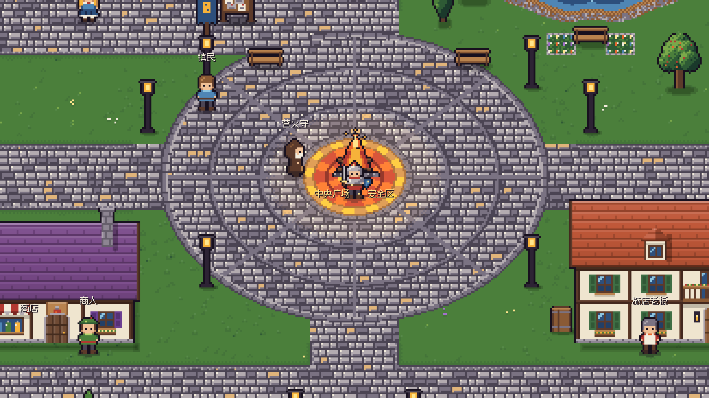
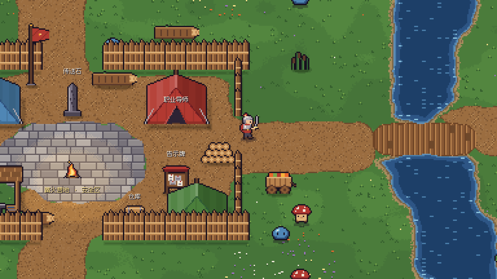
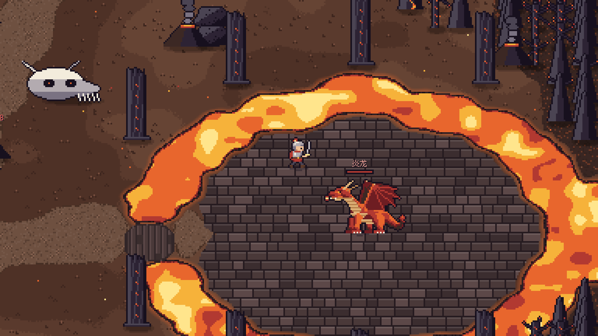

# 篝火荒原

单机像素风动作 RPG，Windows 版。这里只提供游戏下载，不含源码。

## 下载

到 **[Releases](https://github.com/linruihao7/gouhuo-huangyuan-download/releases)** 页面下载最新版本，二选一：

| 文件 | 说明 |
|---|---|
| `Gouhuo-Wildlands-vX.Y.Z-Windows-Setup.exe` | 安装版。安装到 `%LOCALAPPDATA%\Programs\篝火荒原`，不需要管理员权限，带开始菜单快捷方式和卸载程序。新版本可以直接覆盖安装。 |
| `Gouhuo-Wildlands-vX.Y.Z-Windows-Portable.zip` | 免安装版。完整解压后运行 `CampfireNative.exe`，EXE 和 PCK 要放在同一个文件夹里。 |

每个版本都附带 `SHA256SUMS.txt`，可以核对下载的文件是否完整。

## 运行要求

- Windows 10 / 11，64 位。
- 单机游戏，不需要联网、账号、浏览器或其他运行环境。
- 程序和安装包**没有数字签名**，Windows 可能提示“已保护你的电脑”，点“更多信息 → 仍要运行”即可。

## 游戏内容

- 从晨火镇的成人礼开始的序章剧情，篝火荒原、幽暗墓地、熔岩火山、冰封雪原、魔王祭坛五张野外地图，以及第六张地图洛斯里克城。
- 战士、法师、弓手三个职业，技能树和天赋，装备、套装与锻造。

## 存档

- 存档在 `%APPDATA%\CampfireNative\Windows`。卸载游戏、换安装目录都不会删除存档。
- 游戏内「存档与备份」可以导出和导入备份文件。
- 新版本会自动升级旧存档，但升级后的存档不能再用更早的版本打开，更新前建议先导出一份备份。

## 当前状态

目前发布的都是**测试版**（GitHub 上标为“Pre-release”）：自动化测试和安装测试已经通过，但还没有完成真人试玩验收。遇到问题欢迎在 [Issues](https://github.com/linruihao7/gouhuo-huangyuan-download/issues) 里反馈，最好写明版本号、操作步骤，并附上截图。

## 说明

洛斯里克城的地名、敌人和首领名称取自《黑暗之魂 III》（Dark Souls III）。相关名称和商标归 FromSoftware 与 Bandai Namco 所有，本作与它们没有任何关联；游戏里的美术均为原创像素画。
